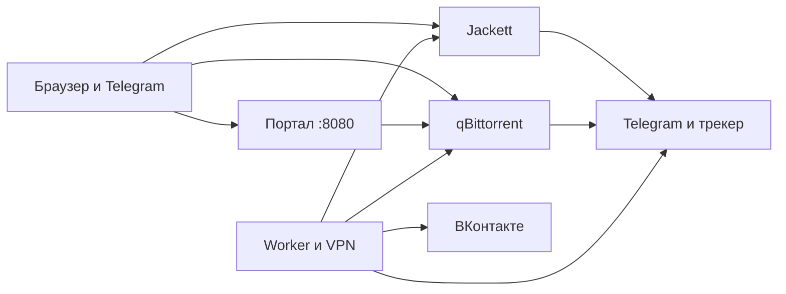

# Поток

Рабочий контейнер медиа-автоматизации: лента трекера, очередь на одобрение, загрузка через qBittorrent и выкладка во ВКонтакте.


[](LICENSE)

Проект под лицензией MIT, файл `LICENSE` лежит в корне репозитория.

1. Скачайте проект и откройте его папку.
2. Запустите `scripts/install.ps1` на Windows или `scripts/install.sh` на Linux и macOS.
3. Дождитесь сайта [http://localhost:8080](http://localhost:8080).
4. Войдите: имя `potok`, пароль `potok`.
5. Пройдите мастер на сайте: свой пароль, ключ Jackett, трекер и ссылка ленты.

Обзор для людей вне проекта: [docs/обзор.md](docs/обзор.md).

Полное описание архитектуры, папок и страниц со снимками: [docs/архитектура.md](docs/архитектура.md).

Пока ссылка ленты Jackett пустая, Поток читает адреса из списка `rss.feeds`. Когда ссылка заполнена, опрос идёт только по ней. Если Jackett не запущен или ключ неверный, цикл опроса останавливается и ошибка пишется в журнал.

Секреты в YAML не пишутся. Живой `config/config.yaml` в git не входит. Образец без паролей — `config/config.yaml.example`. Токены лежат в `data/secrets.enc`.

## Возможности

- Мастер первого запуска на сайте `/setup`: пароль, Jackett, трекер, лента, по желанию Telegram / VK / TMDB и WireGuard
- Сайт на Flask: дашборд, очередь, загрузки, ВК, журнал, настройки, пользователи
- Telegram-бот с теми же решениями «одобрить / отклонить», что и сайт
- Лента Jackett Torznab; запасные RSS, пока своя ссылка пустая
- Фильтры: рейтинг, возраст, жанр, одна копия по качеству и числу сидов
- Обложки и описание через The Movie Database, если задан ключ
- Скачивание через qBittorrent, пауза, скорость и очередь на странице «Загрузки»
- Выкладка видео во ВКонтакте после 30 минут раздачи
- WireGuard внутри worker: в туннель идут только выбранные домены
- Пользователи сайта по логину и паролю. Отдельных ролей (например «только просмотр») нет

## Архитектура

Четыре контейнера. С компьютера открываются три адреса. Jackett и qBittorrent сидят в сети контейнера `worker`, поэтому порты 9117 и 8090 наружу отдаёт `worker`.



| Контейнер | Адрес в браузере | Зачем |
| --- | --- | --- |
| `portal` | http://localhost:8080 | Сайт: вход, очередь, загрузки, ВК, настройки, пользователи |
| `jackett` | http://localhost:9117 | Логин на трекере и готовая лента. Порт публикует `worker` |
| `qbittorrent` | http://localhost:8090 | Загрузки: пауза, скорость, оставшееся время. Порт публикует `worker` |
| `worker` | своего сайта нет | Лента, фильтры, бот Telegram, VPN, постановка в qBittorrent, выкладка в VK |

## Стек

| Часть | Чем сделано |
| --- | --- |
| Язык | Python 3.11 и новее. В контейнере портала стоит Python 3.12 |
| Настройки | YAML, живой файл `config/config.yaml`, образец `config/config.yaml.example` |
| Сайт | Flask и шаблоны Bootstrap 5 |
| Бот | aiogram 3, Telegram |
| Ленты | feedparser и Jackett Torznab |
| Пароли и токены | `data/secrets.enc`, шифр Fernet |
| База очереди | SQLite, в Docker — том `potok-db` |
| Пользователи сайта | SQLite, `data/portal_users.db` |
| Загрузки | qBittorrent |
| Выкладка | API ВКонтакте |
| Обложки | The Movie Database |
| Туннель | WireGuard, маршруты только к выбранным доменам |
| Сборка | Docker Compose, сеть `potok-net` |
| Проверки | Ruff и pytest в `.venv` |

## Telegram

Бот отвечает только человеку, чей числовой id записан в настройках. Токен берётся у `@BotFather` и вставляется в мастер или в настройки сайта, не в YAML.

| Команда | Действие |
| --- | --- |
| `/status` | Сводка по базе и VPN |
| `/pending` | Что ждёт решения |
| `/vk` | Фильмы, уже загруженные во VK |
| `/token` | Срок токена VK и обновление |
| `/update` | Прочитать ленту сейчас |
| `/clear` | Очистить очередь загрузки |
| `/settings` | Текущие фильтры |

Кнопки под сообщением одобряют или отклоняют запись так же, как сайт.

## Папки

```text
Поток
├── docker-compose.yml
├── pyproject.toml
├── README.md
├── scripts
│   ├── install.ps1          Windows
│   └── install.sh           Linux и macOS
├── docs
│   ├── обзор.md
│   ├── архитектура.md
│   └── images
├── config
│   ├── config.yaml.example  образец без паролей
│   ├── wg0.conf.example
│   ├── vpn-resolv.conf
│   ├── jackett-definitions
│   └── qbittorrent
├── src/potok
│   ├── onboarding.py        мастер /setup
│   └── …
├── portal                   образ сайта
├── worker                   образ рабочего контейнера
├── tests
└── assets
```

Живые `config/config.yaml`, `config/wg0.conf`, папка `config/jackett/` и `data/` в git не входят. Скрипт установки копирует примеры, если рабочих файлов ещё нет.

## Главные модули

| Файл | Что делает |
| --- | --- |
| `src/potok/__main__.py` | Команды внутри контейнера: `fetch`, `bot`, `watch`, `publish`, `portal`, `up`, `down`, `status` |
| `src/potok/onboarding.py` | Шаги мастера `/setup` |
| `src/potok/config.py` | Читает YAML и проверяет поля |
| `src/potok/pipeline.py` | Скачивает ленту, фильтрует, ставит в очередь |
| `src/potok/rss.py` | Разбирает RSS |
| `src/potok/jackett.py` | Проверка Jackett и ссылка на `.torrent` |
| `src/potok/filters.py` | Рейтинг, возраст, жанр, выбор одной копии |
| `src/potok/store.py` | База уже виденных и ожидающих записей |
| `src/potok/bot.py` | Telegram, таймер ленты, решения с сайта |
| `src/potok/web.py` | Страницы сайта |
| `src/potok/portal.py` | Запуск сайта в контейнере `portal` |
| `src/potok/qbit.py` | Разговор с qBittorrent |
| `src/potok/publish.py` | Пауза после раздачи и отправка в VK |
| `src/potok/vk_video.py` | Запросы к API ВКонтакте |
| `src/potok/tmdb.py` | Обложка и описание |
| `src/potok/vpn.py` | WireGuard и маршруты к доменам |
| `src/potok/secrets.py` | Шифрование токенов |
| `src/potok/users.py` | Логины портала |

## Для разработки

Пакеты только в `.venv`. В системный Python их не ставят.

```powershell
.\.venv\Scripts\python.exe -m ruff check src tests
.\.venv\Scripts\python.exe -m pytest -q
```

Команды `python -m potok fetch` и `python -m potok bot` — не способ установки. Обычный запуск — скрипт и Docker. Для отладки внутри уже поднятого контейнера:

```powershell
docker exec -it potok-worker python -m potok status
```

Клонирование: подставьте ссылку своего репозитория (для нового аккаунта GitHub — эту). Публичный репозиторий проекта: `https://github.com/potok-git/potok.git`.

```text
git clone <ссылка на ваш репозиторий>
```

## Установка

1. Скачайте проект и откройте его папку.
2. Запустите `scripts/install.ps1` на Windows или `scripts/install.sh` на Linux и macOS.
3. Если Docker ещё нет, скрипт ставит его сам. На Windows появится окно согласия. Если компьютер попросит перезагрузку, перезагрузите его и запустите скрипт ещё раз.
4. Дождитесь, пока скрипт откроет сайт `http://localhost:8080`.
5. Войдите: имя `potok`, пароль `potok`.

## Настройка на сайте

6. Придумайте свой пароль и сохраните его. Старый пароль `potok` после этого не подойдёт.
7. Нажмите кнопку, которая открывает Jackett (`http://localhost:9117`). Справа вверху скопируйте API Key, вставьте его в поле и нажмите «Дальше».
8. Снова откройте Jackett. Нажмите Add Indexer, выберите трекер, введите логин и пароль этого трекера и сохраните. Пароль трекера в Поток копировать не нужно. Вернитесь в мастер и нажмите «Дальше».
9. На карточке трекера в Jackett скопируйте ссылку Torznab Feed, вставьте её в поле ленты и нажмите «Дальше». Список категорий не меняйте.
10. По желанию заполните Telegram, ВКонтакте и ключ обложек TMDB. Можно нажать «Позже». Без токена VK фильмы скачаются, во ВКонтакте не уйдут.
11. По желанию вставьте текст своего VPN WireGuard. Можно нажать «Позже». Без него запросы к Рутрекеру могут не открыться.
12. На экране «Готово» откройте очередь «Ожидают».

Кнопка «Настроить позже» возвращает на главную. Сверху остаётся ссылка «Продолжить настройку». Пока шаги 6–9 не сделаны, после нового входа мастер открывается снова.

## Благодарности

Спасибо проектам [Jackett](https://github.com/Jackett/Jackett), [qBittorrent](https://www.qbittorrent.org/), [The Movie Database](https://www.themoviedb.org/) и [WireGuard](https://www.wireguard.com/).

## ⚖️ Отказ от ответственности (Disclaimer)

Проект «Поток» создавался исключительно в образовательных целях и для автоматизации работы с легальным контентом, находящимся в общественном достоянии (Public Domain), или контентом, на который у пользователя есть соответствующие права.

- **Авторские права:** Автор проекта не несёт ответственности за действия пользователей, связанных с загрузкой и распространением материалов, защищённых авторским правом. Пользователь самостоятельно обязан соблюдать законодательство своей страны (в т.ч. ГК РФ и DMCA).
- **Сторонние сервисы:** Проект использует API сторонних сервисов (ВКонтакте, The Movie Database, Jackett). Автор не несёт ответственности за блокировки аккаунтов со стороны этих сервисов за нарушение их пользовательских соглашений (Terms of Service).
- **Использование:** Вы используете данное программное обеспечение на свой страх и риск.

## Контакты

Почта: [potok.git@gmail.com](mailto:potok.git@gmail.com)
