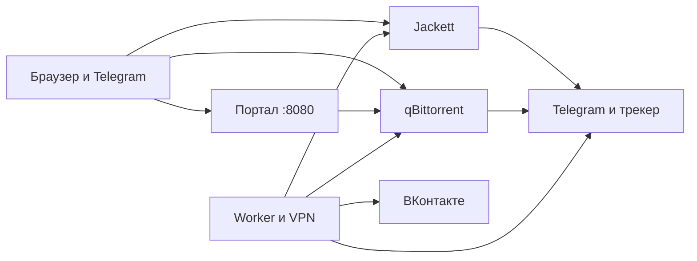
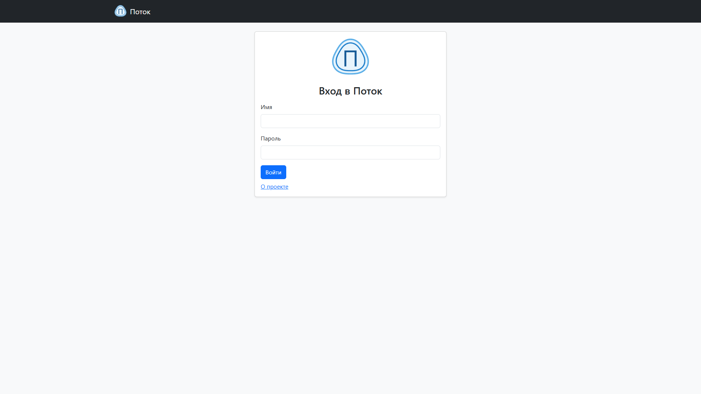
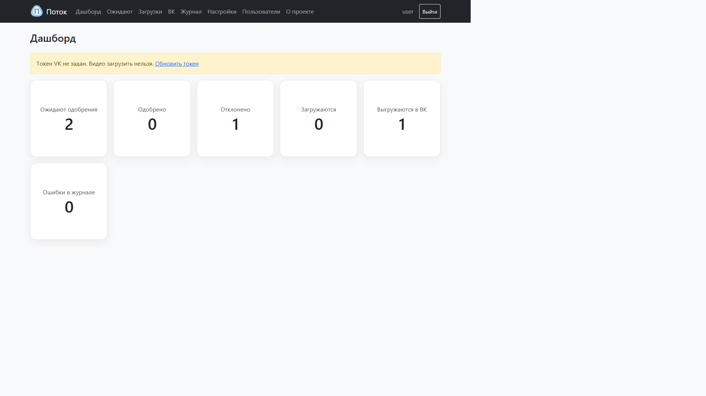
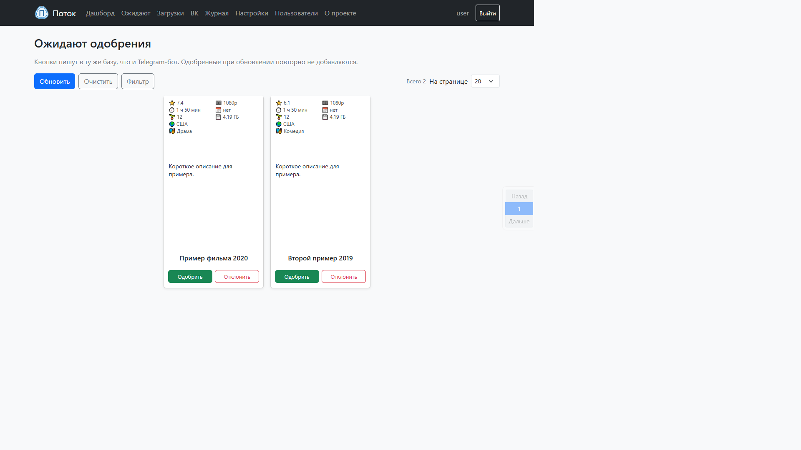
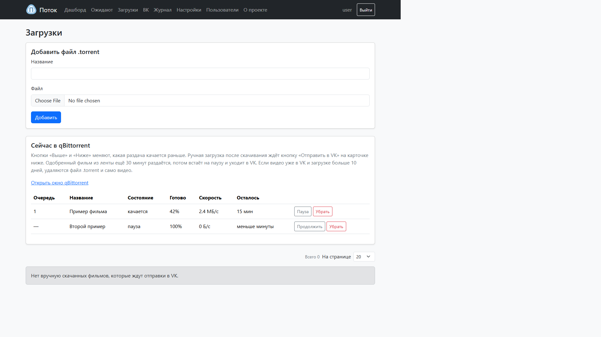
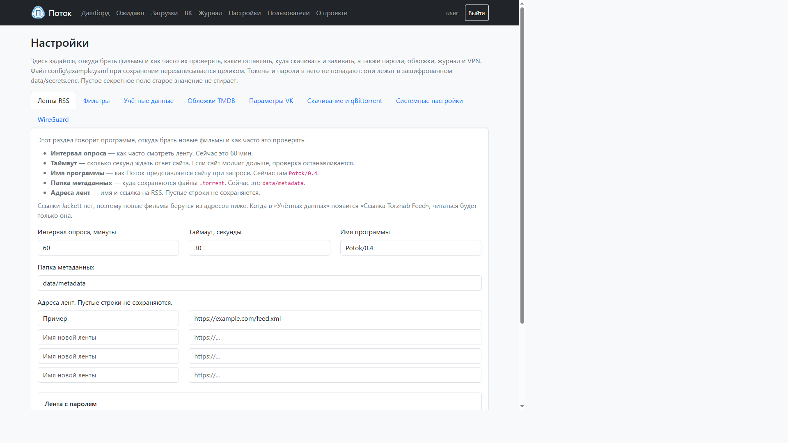
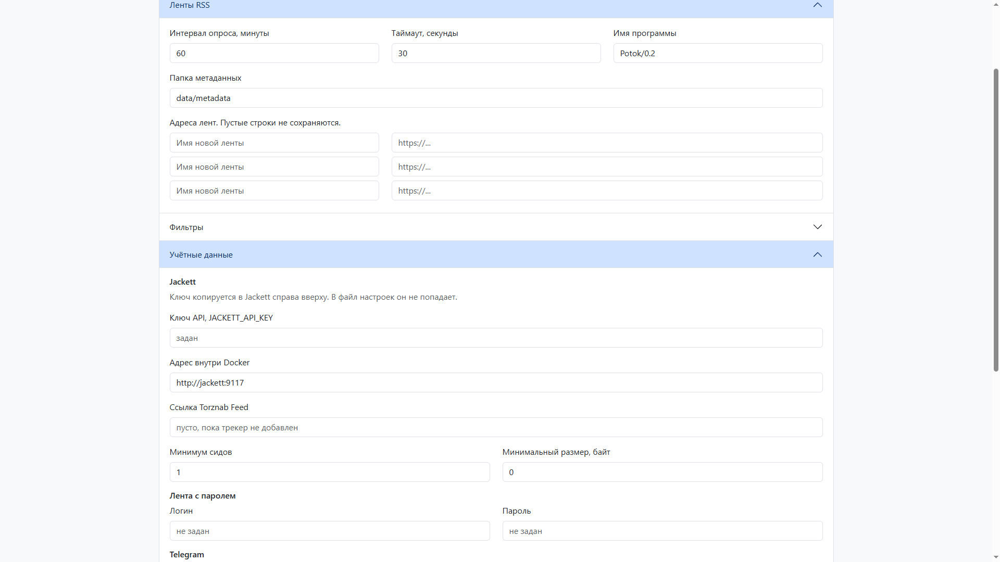
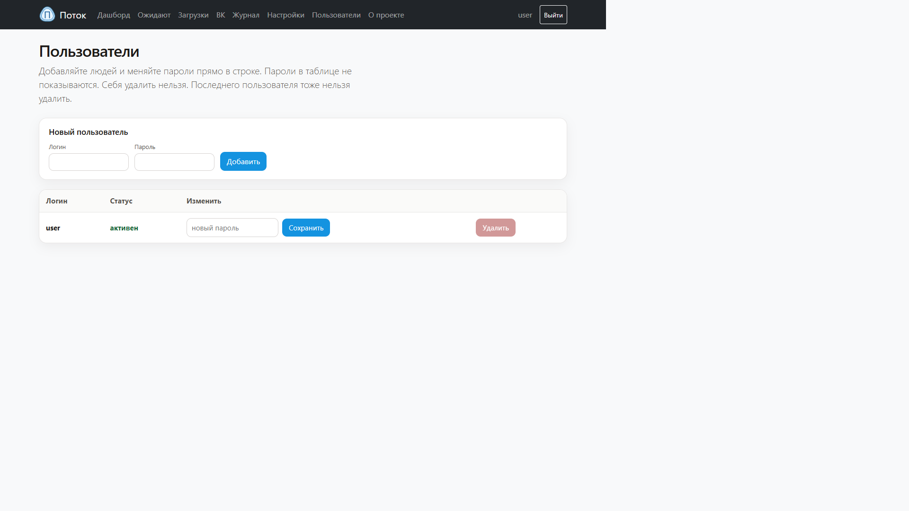
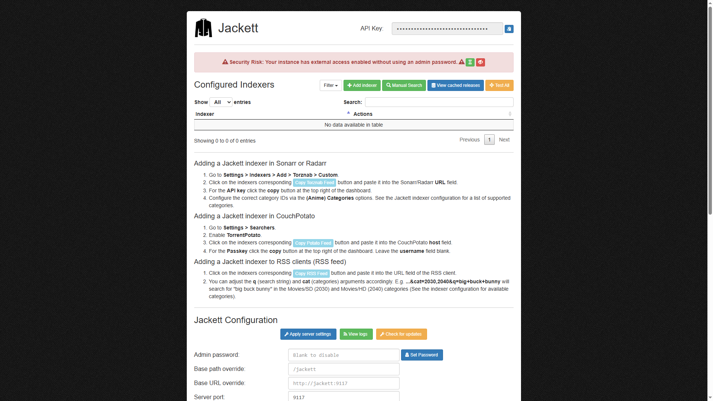

# Поток

Поток забирает новые записи из ленты, показывает их вам на одобрение и после согласия скачивает файл через qBittorrent и может выложить видео во ВКонтакте.

Сайт открывается в браузере: [http://localhost:8080](http://localhost:8080).

## Как это устроено

Четыре контейнера. С компьютера вы открываете три адреса. Jackett и qBittorrent не имеют своей сети: они сидят в сети контейнера `worker`. Поэтому порты 9117 и 8090 наружу отдаёт именно `worker`. Сайт ходит к qBittorrent по имени `worker`.



| Контейнер | Адрес в браузере | Зачем |
| --- | --- | --- |
| `portal` | http://localhost:8080 | Сайт: вход, очередь, загрузки, ВК, настройки, пользователи |
| `jackett` | http://localhost:9117 | Логин на трекере и готовая лента для Потока. Порт публикует `worker` |
| `qbittorrent` | http://localhost:8090 | Загрузки: пауза, скорость, оставшееся время. Порт публикует `worker` |
| `worker` | своего сайта нет | Лента, фильтры, бот Telegram, VPN, постановка в qBittorrent, выкладка в VK |

В `worker` крутится программа на Python. Команда при старте контейнера: `python -m potok bot`. Она слушает Telegram, по таймеру читает ленту и забирает решения с сайта.

VPN внутри `worker` включён постоянно, но маршрут по умолчанию не меняется. В туннель попадают только адреса Telegram, RuTracker и доменов из настройки. Остальной трафик идёт напрямую. Большое видео с других адресов туннель не забирает. Jackett и qBittorrent пользуются той же сетью, поэтому их запросы к этим сайтам идут тем же путём. Файл `config/vpn-resolv.conf` подключён к ним как DNS.

После сохранения настроек сайт перезапускает `worker`, а следом Jackett и qBittorrent: иначе они останутся без сети worker.

Порядок одного цикла:

1. Бот поднимает маршруты VPN и дальше держит их. Каждый круг ленты туннель заново не включает и не выключает.
2. Jackett отдаёт ленту. Если ссылка `jackett_rss_url` ещё пустая, Поток читает адреса из списка `rss.feeds`. Перед опросом программа проверяет, что Jackett отвечает и принимает ключ. Если нет, этот круг останавливается, ошибка пишется в журнал.
3. Новые записи проходят фильтры: рейтинг, возраст, жанр и шаблон качества. Из нескольких копий одного фильма остаётся одна. Какую брать, задаёт настройка качества: максимальное, ближайшее к 1080p или минимальное. При равном качестве остаётся раздача с большим числом сидов.
4. Подходящие попадают в базу со статусом «ожидает». Обложку и описание, если задан ключ, программа берёт в The Movie Database.
5. Вы нажимаете «Одобрить» на сайте или в Telegram. Сайт пишет решение в файл `data/portal_jobs.jsonl`, бот читает его и делает ту же работу, что по кнопке в чате.
6. Программа скачивает маленький файл `.torrent`. qBittorrent качает видео в `data/downloads`.
7. Докачанный фильм из ленты ещё 30 минут раздаётся, потом встаёт на паузу и уходит во ВКонтакте. Файл, который положили руками на странице «Загрузки», сам не уходит: нужна кнопка «Отправить в VK».
8. Если видео уже лежит в VK и загрузке больше 10 дней, Поток удаляет файл `.torrent` и само видео. Ролик во ВК при этом остаётся.

Команда `publish --torrent` и файл `.torrent`, присланный боту в чат, по-прежнему могут качать видео через aria2c. Обычный путь с сайта и из ленты — qBittorrent.

## Стек

| Часть | Чем сделано |
| --- | --- |
| Язык | Python 3.11 и новее. В контейнере портала стоит Python 3.12 |
| Настройки | YAML, файл `config/config.yaml` |
| Сайт | Flask и шаблоны Bootstrap 5 |
| Бот | aiogram 3, Telegram |
| Ленты | feedparser и Jackett Torznab |
| Jackett | библиотека `requests`. Описание RuTracker с чтением следующих страниц лежит в `config/jackett-definitions` |
| База очереди | SQLite, файл `data/db/seen.db` |
| Пользователи сайта | SQLite, файл `data/portal_users.db` |
| Пароли и токены | файл `data/secrets.enc`, шифр Fernet из пакета `cryptography` |
| Загрузки | qBittorrent. Разговор с ним в `src/potok/qbit.py` |
| Выкладка в VK | API ВКонтакте, прогресс в `data/vk_uploads.json` |
| Обложки | The Movie Database |
| Туннель | WireGuard внутри образа linuxserver. Маршруты только к выбранным доменам |
| Сборка контейнеров | Docker Compose, сеть `potok-net` |
| Проверки кода | Ruff и pytest, окружение `.venv` |

Секреты в `config.yaml` не пишутся. Туда попадает только имя переменной, например `JACKETT_API_KEY`. Само значение лежит в `data/secrets.enc` или в окружении PowerShell.

База очереди в Docker лежит на томе `potok-db`, а не в папке Windows. Иначе журнал SQLite на общей папке ломается. Секреты, видео и журналы остаются в папке `data`.

## Папки и файлы

```text
Поток
├── docker-compose.yml      четыре сервиса
├── pyproject.toml          зависимости и настройки Ruff/pytest
├── README.md               короткая настройка Jackett
├── docs
│   ├── архитектура.md      этот документ
│   ├── обзор.md            короткая ссылка на страницу «О проекте»
│   └── images              снимки страниц
├── config
│   ├── config.yaml         настройки без паролей
│   ├── wg0.conf.example    образец туннеля
│   ├── wg0.conf            ваш туннель, в git не входит
│   ├── vpn-resolv.conf     DNS для Jackett и qBittorrent
│   ├── jackett-definitions описание трекера с чтением следующих страниц
│   ├── qbittorrent         образец настроек загрузчика
│   └── jackett             пароли трекеров, в git не входит
├── data                    секреты, видео, журналы; база очереди в Docker — на томе
├── src/potok               программа
├── worker                  образ рабочего контейнера
├── portal                  образ сайта
└── tests                   проверки pytest
```

Главные файлы программы:

| Файл | Что делает |
| --- | --- |
| `src/potok/__main__.py` | Команды: `fetch`, `bot`, `watch`, `publish`, `portal`, `demo`, `up`, `down`, `status`, `probe` |
| `src/potok/config.py` | Читает `config.yaml` и проверяет поля |
| `src/potok/pipeline.py` | Скачивает ленту, фильтрует, ставит записи в очередь |
| `src/potok/rss.py` | Разбирает RSS в одинаковый список |
| `src/potok/jackett.py` | Проверка Jackett и поиск ссылки на `.torrent` |
| `src/potok/filters.py` | Рейтинг, возраст, жанр и выбор одной копии по качеству |
| `src/potok/store.py` | База уже виденных и ожидающих записей |
| `src/potok/bot.py` | Telegram, таймер ленты, решения с сайта и отправка в VK |
| `src/potok/web.py` | Страницы сайта |
| `src/potok/templates` | Внешний вид страниц |
| `src/potok/portal.py` | Запуск сайта в контейнере `portal` |
| `src/potok/qbit.py` | Разговор с qBittorrent |
| `src/potok/publish.py` | Пауза после 30 минут раздачи и отправка файла в VK |
| `src/potok/vk_video.py` | Запросы к API ВКонтакте |
| `src/potok/vk_oauth.py` | Токен VK: вставка, срок и проверка |
| `src/potok/vk_uploads.py` | Прогресс и порядок выгрузки в VK |
| `src/potok/tmdb.py` | Обложка и описание фильма |
| `src/potok/titles.py` | Короткое русское имя из файла `.torrent` |
| `src/potok/vpn.py` | Постоянный WireGuard и маршруты только к выбранным доменам |
| `src/potok/secrets.py` | Шифрование токенов |
| `src/potok/settings_io.py` | Запись настроек из формы сайта |
| `src/potok/users.py` | Логины портала |
| `src/potok/jobs.py` | Очередь решений с сайта для бота |
| `src/potok/restart.py` | Перезапуск worker, Jackett и qBittorrent после сохранения настроек |
| `src/potok/logs.py` | Журнал worker для страницы «Журнал» |
| `src/potok/feed_refresh.py` | Чтение ленты в фоне, пока открыта страница «Ожидают» |

Команды внутри `worker`:

```text
python -m potok fetch     забрать ленту один раз
python -m potok bot       слушать Telegram и опрашивать ленту по расписанию
python -m potok watch     то же расписание без Telegram
python -m potok publish   догрузить готовое видео в VK
python -m potok up        включить VPN и маршруты к доменам
python -m potok down      выключить VPN
python -m potok status    показать, включён ли туннель
python -m potok probe     проверить туннель и не выключать его
```

С вашего компьютера та же команда выглядит так:

```powershell
docker exec -it potok-worker python -m potok status
```

## Справка по страницам

Снимки сделаны с работающего портала на этом компьютере.

Меню сайта: дашборд, ожидают, загрузки, ВК, журнал, настройки, пользователи, о проекте. Списки «Одобренные» и «Отклонённые» открываются с плиток дашборда.

### Вход

Адрес [http://localhost:8080](http://localhost:8080). После первого входа смените пароль на странице «Пользователи».



### Дашборд

Главная страница после входа. Шесть плиток: очередь, одобренные, отклонённые, загрузки, выгрузка в VK и ошибки в журнале. Сверху плашка про токен VK: он есть, срок неизвестен или уже истёк.



### Ожидают

Список, по которому вы говорите «да» или «нет». Записи стоят карточками. На карточке бывают обложка, год, рейтинг, качество, жанр и число сидов. Кнопки пишут в ту же базу, что и Telegram.

Сверху кнопки «Обновить» и «Очистить». Список можно сузить по жанру и качеству и листать страницами.



Одобрение можно снять: фильм вернётся в очередь. Ролик, который уже лежит во ВК, при этом не удаляется.

### Загрузки

Сюда можно положить свой файл `.torrent`. Ниже видно раздачи qBittorrent: состояние, процент, скорость и сколько осталось. Кнопки «Выше» и «Ниже» меняют порядок. «Пауза», «Продолжить» и «Убрать» управляют одной загрузкой. «Убрать» снимает раздачу из списка, файл на диске при этом остаётся.

Фильм из ленты после скачивания ещё 30 минут раздаётся, потом встаёт на паузу и уходит в VK. Файл, который положили руками, ждёт кнопку «Отправить в VK» на карточке.

Если выгрузка в VK прошла и загрузке больше 10 дней, Поток удаляет файл `.torrent` и само видео.



Ссылка «Открыть окно qBittorrent» ведёт на [http://localhost:8090](http://localhost:8090).

### ВК

Ролики, которые уже лежат во ВКонтакте: название, описание и ссылка. Название и описание можно поправить, ролик можно удалить. Пока файл ещё едет, прогресс виден в очереди выгрузки: верхний уходит первым, следующий ждёт. Плейлисты называются «год — жанр».

### Настройки

Форма переписывает `config.yaml`. Комментарии в файле при сохранении заменяются. Пароли в файл не попадают: пустое секретное поле старое значение не стирает. После сохранения сайт перезапускает службу ленты.

Сверху задаются интервал опроса ленты и запасные адреса RSS. Остальное разложено по вкладкам.



Блок «Учётные данные» хранит ключ Jackett, минимум сидов, токен Telegram, токен VK и пароль qBittorrent. Ключ Jackett копируется в его окне справа вверху и вставляется в поле **Ключ API, JACKETT_API_KEY**. Ссылка **Torznab Feed** вставляется в поле ниже.



Остальные вкладки:

- **Фильтры** — минимальный рейтинг, возраст в днях, жанры и какое качество оставлять.
- **Обложки TMDB** — ключ The Movie Database. По нему бот и карточки получают постер и описание.
- **Параметры VK** — куда и какими кусками заливать видео, срок токена.
- **Скачивание и qBittorrent** — папка видео и адрес загрузчика. Поля aria2c остаются для запасного пути.
- **Системные настройки** — база, журнал и какие домены идут через VPN.
- **WireGuard** — текст туннеля. Файл `wg0.conf` в git не попадает.

Внизу кнопка **Сохранить настройки**.

### Пользователи

Кто может открывать сайт. Здесь добавляют человека, меняют пароль и удаляют лишний вход. Последнего пользователя удалить нельзя: иначе в портал больше никто не войдёт. Себя удалить тоже нельзя.



### Журнал

Пункт меню **Журнал** показывает файл `data/logs/worker.log`. Новые строки дописываются сами. На снимок эта страница не попала: в живом журнале бывают ссылки VK и служебные адреса, их не стоит класть в документ.

### О проекте

Пункт меню **О проекте**, адрес `/about`. Короткий рассказ без паролей и живого журнала. Текст страницы лежит в `src/potok/templates/about.html`, снимки — в `src/potok/static/about`.

### Jackett

Адрес [http://localhost:9117](http://localhost:9117). Здесь добавляются трекеры. Ключ API на снимке закрыт точками.



Как подключить трекер:

1. В терминале, в папке проекта: `docker compose up -d jackett`.
2. Откройте http://localhost:9117.
3. Справа вверху скопируйте API Key и вставьте его на портале в поле **Ключ API, JACKETT_API_KEY**.
4. Нажмите зелёную кнопку **Add indexer**, выберите трекер, введите его логин и пароль, сохраните.
5. На карточке трекера нажмите **Copy Torznab Feed**.
6. Вставьте ссылку на портале в поле **Ссылка Torznab Feed** и нажмите **Сохранить настройки**.
7. Если в ссылке уже есть `apikey=`, эту часть можно стереть: рабочий ключ подставится из секрета.
8. Розовая полоса на снимке предлагает задать пароль администратора Jackett. Это отдельный пароль на само окно Jackett. Кнопка **Set Password** внизу страницы.

Пока поле ленты пустое, Поток читает старые адреса из блока «Ленты RSS».

### qBittorrent

Адрес [http://localhost:8090](http://localhost:8090). Управлять загрузками удобнее со страницы портала «Загрузки»: там пауза, скорость, порядок и оставшееся время. Готовое видео появляется в папке `data/downloads`.

### Telegram

Бот отвечает только человеку, чей числовой id записан в `POTOK_TELEGRAM_CHAT_ID`. Токен берётся у `@BotFather` и кладётся в настройки портала, не в `config.yaml`.

Меню бота повторяет портал: дашборд, ожидают, загрузки, ВК. На карточке бывают обложка и описание.

Команды:

| Команда | Действие |
| --- | --- |
| `/status` | Сводка по базе и VPN |
| `/pending` | Что ждёт решения |
| `/vk` | Фильмы, уже загруженные во VK |
| `/token` | Срок токена VK и обновление |
| `/update` | Прочитать ленту сейчас |
| `/clear` | Очистить очередь загрузки |
| `/settings` | Текущие фильтры |

Кнопки под сообщением одобряют или отклоняют запись так же, как сайт.

## Запуск и обновление

Откройте терминал и перейдите в папку проекта:

```powershell
cd путь\к\папке\проекта
```

Поднять всё:

```powershell
docker compose up -d --build
```

Только сайт, после правки страниц:

```powershell
docker compose up -d --build portal
```

После пересборки обновите браузер клавишей **F5**. Если страница не открывается, посмотрите, не перезапускается ли контейнер:

```powershell
docker ps -a --filter name=potok
docker logs potok-portal --tail 40
```

Проверки программы на Windows, без Docker:

```powershell
.\.venv\Scripts\python.exe -m ruff check src tests
.\.venv\Scripts\python.exe -m pytest -q
```

Пакеты ставятся только в `.venv`, командой `.\.venv\Scripts\pip.exe`. В системный Python их не ставят.
